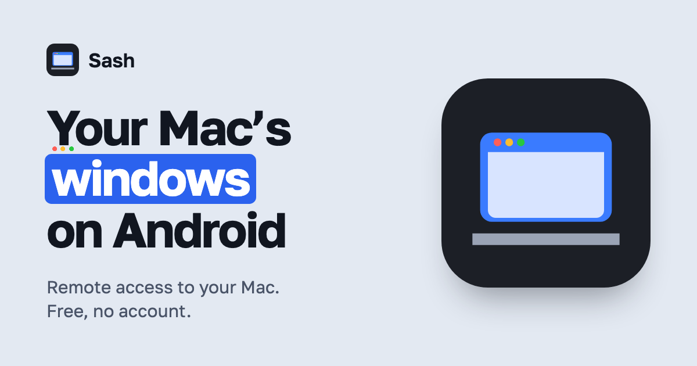

  

  
  
  
  

  <b>English</b> · <a href="README.ru.md">Русский</a> · <a href="https://usesash.app">usesash.app</a>

  <a href="https://github.com/ilyabazhenov/sash/releases/latest"><b>⬇ Download for Android (APK)</b></a> &nbsp;·&nbsp;
  <a href="https://github.com/ilyabazhenov/sash/releases/latest"><b>⬇ Download for Mac (DMG)</b></a>

---

**Sash** puts your Mac's windows and its whole desktop on an Android phone, foldable or tablet. Drive it with touch, a keyboard, a mouse or a stylus: at home over Wi‑Fi, or away through your own VPN. No account and no cloud: the phone talks to your Mac directly, encrypted end to end.

## Highlights

| | |
|---|---|
| 🪟 **A window or the whole desktop** | Live thumbnails of every open window, the Desktop one tap away, every app on the Mac with search and launch. |
| 👆 **Touch that feels native** | Tap to click, long press to right-click, a loupe for precise aim, drag, scrolling with momentum. A mouse, touchpad or stylus acts as the Mac's own. |
| 💻 **Laptop mode** | Phone upright: the picture on top, a row of Mac keys and a trackpad below. Three-finger gestures for Mission Control, App Exposé, Spaces and Show Desktop. |
| ⌨️ **A real keyboard** | On-screen keys with latching ⌘ ⌥ ⌃ ⇧, or a hardware keyboard sending every key as is. |
| 📋 **Clipboard both ways** | Copy on the Mac and paste on the phone; send text back with “Paste on Mac”. |
| 🍎 **The Mac's menus** | The frontmost app's menu bar, with submenus and shortcuts, right on the phone. |
| ⚡ **Smooth video** | HEVC up to 120 fps, decoded in hardware; quality, resolution and frame rate set from the phone. |
| 🔒 **Private by design** | Pairing by QR code or a 12‑digit code, TLS 1.3 with pinned keys, the device key in the Android Keystore, an optional fingerprint or face lock. |
| 🌍 **Away from home** | Through Tailscale or any VPN, or a forwarded port; the app tries every address of the Mac at once. |

## Get started

1. **On the Mac:** download `Sash-<version>.dmg` from [Releases](https://github.com/ilyabazhenov/sash/releases/latest), drag Sash to Applications, open it and allow Screen Recording and Accessibility.
2. **On Android:** download `Sash-<version>.apk` and install it (allow installs from your browser or file manager when asked).
3. Join the same Wi‑Fi, open Sash, tap your Mac and scan the QR code it shows, or type its 12‑digit code.
4. **Away from home:** turn on Remote Access in Sash on the Mac, then use Tailscale (or another VPN) on both devices, or forward its port on your router.

> **Updates:** add `https://github.com/ilyabazhenov/sash` to [Obtainium](https://github.com/ImranR98/Obtainium) and new versions install over the old one by themselves.

## Requirements

- **Mac:** Apple silicon, macOS 14 Sonoma or later.
- **Android:** Android 10 or later; phones, foldables and tablets.

## Feedback

Found a bug or missing something? [Open an issue](https://github.com/ilyabazhenov/sash/issues).

## License

Sash is free to download and use under its [license agreement](LICENSE). The open-source components it includes are listed in [THIRD-PARTY-NOTICES.txt](THIRD-PARTY-NOTICES.txt).
