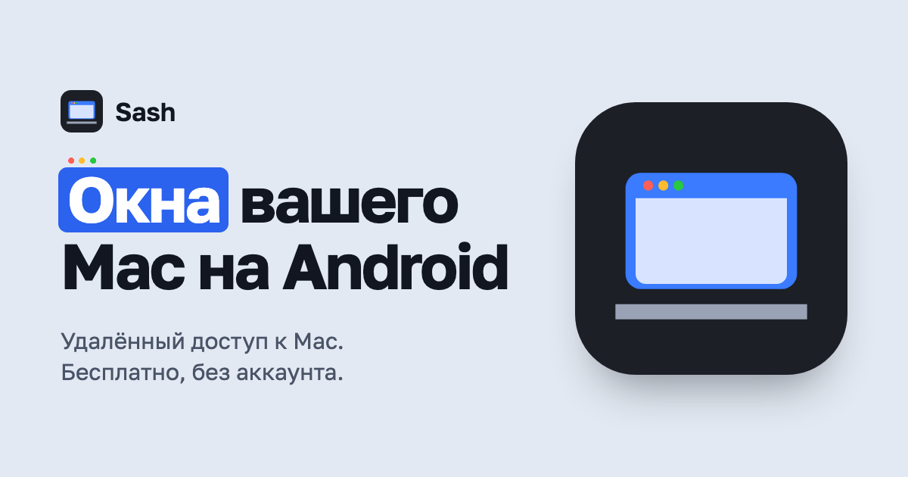

  

  
  
  
  

  <a href="README.md">English</a> · <b>Русский</b> · <a href="https://usesash.app/ru/">usesash.app</a>

  <a href="https://github.com/ilyabazhenov/sash/releases/latest"><b>⬇ Скачать для Android (APK)</b></a> &nbsp;·&nbsp;
  <a href="https://github.com/ilyabazhenov/sash/releases/latest"><b>⬇ Скачать для Mac (DMG)</b></a>

---

**Sash** показывает окна Mac и весь его рабочий стол на телефоне, складном или планшете с Android. Управляйте касаниями, клавиатурой, мышью или стилусом: дома по Wi‑Fi, вне дома через свой VPN. Без аккаунта и без облака: телефон говорит с Mac напрямую, по зашифрованному каналу.

## Возможности

| | |
|---|---|
| 🪟 **Окно или весь рабочий стол** | Живые миниатюры открытых окон, рабочий стол в одно касание, все приложения Mac с поиском и запуском. |
| 👆 **Естественные касания** | Касание — клик, долгое нажатие — правый клик, лупа для точного прицела, перетаскивание, прокрутка с инерцией. Мышь, тачпад и стилус работают как мышь Mac. |
| 💻 **Режим ноутбука** | Телефон вертикально: картинка сверху, ряд клавиш Mac и трекпад снизу. Жесты тремя пальцами: Mission Control, App Exposé, Spaces, рабочий стол. |
| ⌨️ **Настоящая клавиатура** | Экранные клавиши с залипающими ⌘ ⌥ ⌃ ⇧ или аппаратная клавиатура, которая передаёт каждую клавишу как есть. |
| 📋 **Буфер обмена в обе стороны** | Копируйте на Mac и вставляйте на телефоне; текст с телефона — кнопкой «Вставить на Mac». |
| 🍎 **Меню Mac** | Строка меню текущего приложения с подменю и сочетаниями клавиш прямо на телефоне. |
| ⚡ **Плавное видео** | HEVC до 120 к/с с аппаратным декодированием; качество, разрешение и частоту кадров можно менять с телефона. |
| 🔒 **Приватность** | Сопряжение по QR-коду или 12-значному коду, TLS 1.3 с закреплёнными ключами, ключ устройства в Android Keystore, блокировка отпечатком или лицом. |
| 🌍 **Вне дома** | Через Tailscale или любой VPN либо проброшенный порт; приложение пробует все адреса Mac сразу. |

## Как начать

1. **На Mac:** скачайте `Sash-<версия>.dmg` из [Releases](https://github.com/ilyabazhenov/sash/releases/latest), перетащите Sash в «Программы», откройте и разрешите запись экрана и универсальный доступ.
2. **На Android:** скачайте `Sash-<версия>.apk` и установите (разрешите установку из браузера или файлового менеджера, когда спросят).
3. Подключитесь к той же Wi‑Fi, откройте Sash, нажмите на свой Mac и отсканируйте его QR-код или введите 12-значный код.
4. **Вне дома:** включите удалённый доступ в Sash на Mac, затем Tailscale (или другой VPN) на обоих устройствах либо проброс порта на роутере.

> **Обновления:** добавьте `https://github.com/ilyabazhenov/sash` в [Obtainium](https://github.com/ImranR98/Obtainium), и новые версии будут ставиться поверх старых сами.

## Требования

- **Mac:** Apple silicon, macOS 14 Sonoma или новее.
- **Android:** Android 10 или новее; телефоны, складные и планшеты.

## Обратная связь

Нашли ошибку или чего-то не хватает? [Создайте issue](https://github.com/ilyabazhenov/sash/issues).

## Лицензия

Sash можно бесплатно скачивать и использовать по [лицензионному соглашению](LICENSE). Открытые компоненты в его составе перечислены в [THIRD-PARTY-NOTICES.txt](THIRD-PARTY-NOTICES.txt).
